# Tá Faltando? Mercadinho de última hora que entende o jeito que a gente fala

Faltou alguma coisa em casa e o mercado já fechou. Hoje a pessoa abre um app de entrega, escolhe a loja, procura cada produto, compara marcas e só então paga. Para três itens são uns dez toques.

Este projeto testa outra ideia: uma conversa e nenhuma escolha. O cliente escreve do jeito dele, "2 coca e um miojo de tomate", e o atendente monta o carrinho sozinho, fala o total e manda o Pix. Ele também aceita o link de uma receita: lê os ingredientes, coloca no carrinho os principais, lembra do que a pessoa provavelmente já tem em casa e avisa o que está faltando no mercado.

Quando o produto não existe, ele não inventa. Se o cliente pede manjericão e o mercado só tem orégano, ele oferece a troca, explica o que muda no prato e só coloca no carrinho se o cliente aceitar. Bebida alcoólica só entra depois de confirmar que a pessoa tem 18 anos. Pagamento confirmado vira pedido gravado, com os itens e o número de mensagens que o cliente precisou mandar até pagar.

O mercado é fictício e roda em modo demonstração, com Pix de teste e tudo em planos gratuitos.

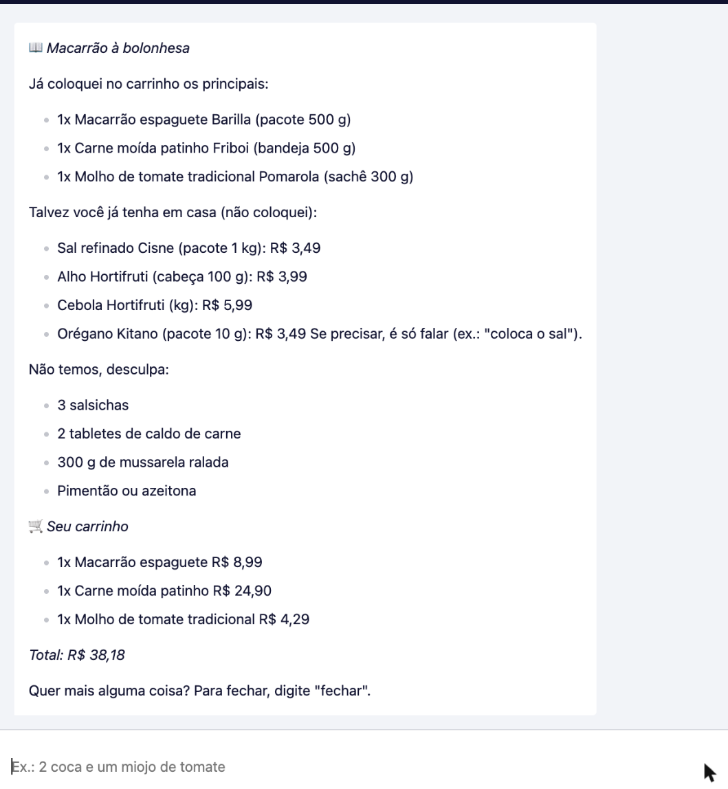

## O que eu testei

Escrevi 35 pedidos como as pessoas escrevem de verdade: apelido ("bombril", "breja", "danone"), quantidade por extenso ("uma dúzia de ovos"), produto que não existe ("picanha"), marca que não tem ("nescau") e correções no meio da conversa ("tira uma coca", "muda pra 4"). Para cada um anotei antes qual carrinho era o certo e conferi o carrinho que o sistema montou.

A primeira rodada achou dois erros que poderiam dar problema de verdade:

- "uma dúzia de ovos" virava 12 bandejas de ovos, um carrinho de R$ 166,80. A IA contava ovos e o catálogo vende bandeja. Corrigi a regra de quantidade, que agora é sempre na unidade de venda.
- "uma coca zero" virava Coca-Cola comum, sem avisar. Para quem tem diabetes, isso é grave. Agora existe uma trava no código: quem pede zero recebe primeiro as opções zero que existem e, depois, o mesmo sabor comum com o aviso de que tem açúcar. Na mesma conversa o bot lembra que o cliente prefere zero.

Na segunda rodada sobrou um erro: "vinho tinto seco" entrava direto como vinho suave. Coloquei uma segunda trava, que confere a resposta da IA contra a tabela de trocas, e repeti o teste até ele virar pergunta.

| O que foi medido | Resultado |
|---|---|
| Pedidos com o carrinho certo (2ª rodada) | 34 de 35 (97%); o que errou foi corrigido e testado de novo |
| Pedidos com o carrinho certo (3ª rodada, com sugestão e pesquisa) | 40 de 40 |
| Revisão procurando erro (15 casos difíceis: áudio com ruído, lista borrada, vídeo que não é receita) | 5 erros achados, 4 corrigidos; depois disso os 40 casos de novo: 40 de 40 |
| Produto inventado pela IA | nenhum (o código descarta qualquer código de produto que não exista) |
| Troca colocada no carrinho sem o cliente aceitar | nenhuma depois das travas |
| Tempo de resposta com IA | 2ª rodada: 5,3 s na mediana e 14,6 s nos 5% mais lentos. 3ª rodada (48 mensagens): 2,9 s na mediana e 18,1 s nos 5% mais lentos |
| Tempo de resposta sem IA (menu, carrinho, fechar) | menos de 1 s |
| Receita por link | ingredientes lidos direto da página em 1 mensagem |
| Foto da lista escrita à mão | 6 de 6 itens lidos e no carrinho, 4,7 s |
| Áudio | 3 de 3 itens entendidos e no carrinho, 4,4 s |
| Receita de vídeo do YouTube | descrição lida em cerca de 8 s; vídeo sem lista na descrição assistido pelo Gemini em 7 a 60 s |
| Mensagens até pagar | 3 (pedido, "fechar", "paguei") |
| Erros de execução registrados | 0 em 95 mensagens |

A IA só faz uma coisa: entender o texto. Preço, total, estoque, idade e Pix são regras fixas no código. Cada mensagem fica registrada numa tabela, com o tempo de resposta e se usou IA ou não, e é dela que saem os números acima.

Passei 15 anos gerenciando operação de comida que funciona de madrugada. Conheço o cliente que liga às 23h porque faltou o molho do macarrão. Este projeto é para ele.

---

## Como funciona por dentro

### Stack

| Camada | Ferramenta |
|---|---|
| Conversa | Chat do n8n (canal plugável; o WhatsApp da Meta ficou bloqueado na criação da conta, veja abaixo) |
| Orquestração | n8n Community, self-hosted em Docker |
| IA | Google Gemini `gemini-3.5-flash-lite` via nó LangChain do n8n, temperatura 0,1 (plano gratuito) |
| Banco | Airtable: Catálogo (43 produtos), Substituições (24 trocas com fonte), Aprendizados (apelidos novos), Pedidos, Itens do pedido, Eventos |
| Pagamento | Asaas Sandbox: cobrança Pix, copia e cola e consulta de status |
| Receita | Página baixada pelo n8n; ingredientes lidos do JSON-LD `recipeIngredient` |

### O fluxo

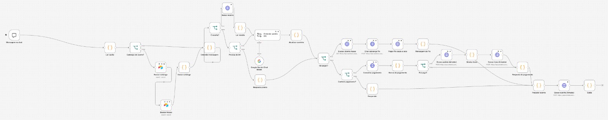

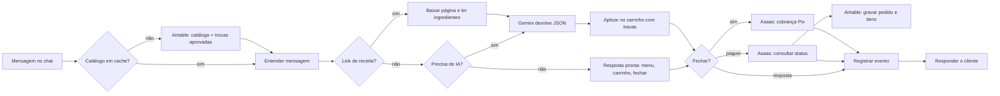

### Decisões que importam

**A IA entende, o código decide.** O Gemini recebe o catálogo, o carrinho e a última mensagem do atendente, e só pode devolver um JSON com operações (adicionar, remover, definir), dúvidas e o que não temos. Quem calcula preço, confere estoque e monta a resposta é um nó de código. Código de produto que não existe no catálogo é descartado.

**Atalho não gasta IA.** "oi", "menu", número de categoria, "carrinho", "fechar" e "paguei" são respondidos por regra, em menos de 1 segundo. A IA só entra quando é pedido em texto livre ou link.

**Troca só com fonte.** As 24 trocas da tabela Substituições foram montadas a partir de guias de culinária (Purdue Extension, TudoGostoso, Band Receitas, Vitat), com o que muda no prato e um nível de risco. O texto "o que muda" vem da tabela, nunca da IA. Ingrediente estrutural, como fermento, farinha e gelatina, tem risco alto: o sistema avisa que falta e não sugere troca. Uma troca nova só vale depois de aprovada.

**Receita em três grupos.** O link é baixado e os ingredientes saem dos dados estruturados da página. Os principais (massa, carne, molho) vão para o carrinho. Os básicos (sal, alho, cebola) aparecem como "talvez você já tenha em casa". O que o mercado não tem vem numa lista. Se o site bloquear o acesso, o sistema monta pelo nome do prato no link e avisa.

**Receita de vídeo do YouTube.** Com link do YouTube (vídeo normal ou Short), o sistema lê primeiro a descrição do vídeo. Se ela tiver a lista de ingredientes, usa a lista, que é o caminho mais rápido. Se não tiver, o Gemini assiste o vídeo pelo link e anota os ingredientes que aparecem ou são falados, no plano gratuito. A resposta diz qual dos dois caminhos foi usado. Se o vídeo não abrir, monta pelo título e avisa. Quando a receita pede algo que não temos e a troca já está no carrinho (tomate pelati, com o molho de tomate já incluído), o bot só avisa, sem oferecer o mesmo produto de novo.

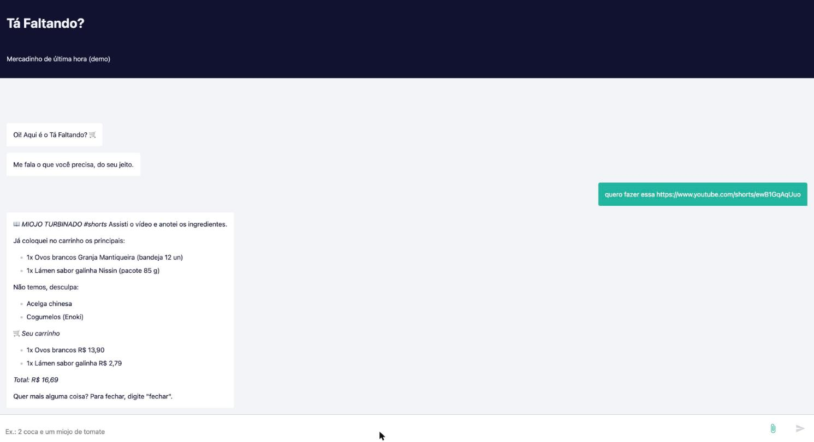

**Aprende apelido novo, com trava contra trote.** Quando o cliente chama um produto de um jeito que não está no catálogo ("refrigerante de cola") e a IA acerta, o termo fica guardado como candidato. Ele só é gravado depois que o cliente paga, porque pagar é a prova de que a IA entendeu certo. Na tabela Aprendizados, o termo vira oficial quando 2 clientes diferentes pagaram com ele, ou quando o dono muda o status para "Oficial". Se o dono marcar "Rejeitado", o termo nunca mais volta. O apelido oficial passa a valer na hora, na próxima mensagem de qualquer cliente, sem treinar modelo nenhum: ele entra na lista "Como o povo chama" que vai junto com o catálogo para a IA.

**Foto da lista e áudio.** O cliente pode mandar a foto da lista escrita à mão ou um áudio, pelo clipe do chat. O Gemini só transcreve o pedido do jeito que está escrito ou falado ("1 dz ovos", "bombril"), e esse texto segue o mesmo caminho de uma mensagem digitada, com as mesmas regras e travas. A resposta mostra primeiro o que foi lido ("Li na sua lista: ..."), para o cliente conferir. Se não der para ler, o bot pede para mandar de novo ou escrever.

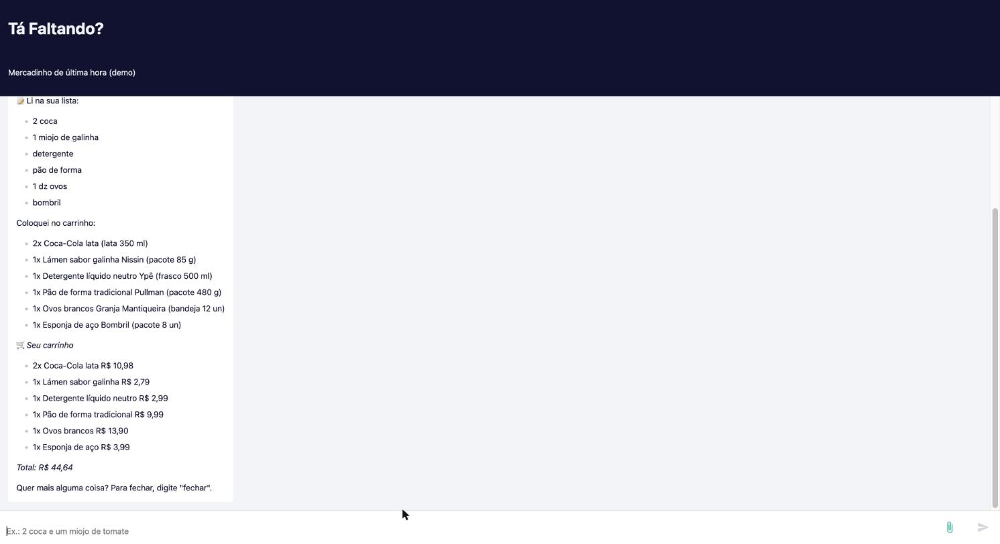

**Pesquisa o que não conhece.** Se o cliente pede algo que não está no catálogo e não tem troca na tabela ("trakinas", "jerimum"), o sistema procura o termo na Wikipédia em português e o Gemini lê só os trechos encontrados. A resposta diz a fonte ("Pesquisei na Wikipédia: é marca brasileira de biscoito recheado") e oferece o produto mais parecido, que só entra no carrinho se o cliente aceitar. Se nenhum trecho explica o termo, o bot não inventa e diz que não tem. O resultado fica guardado, então o mesmo termo não é pesquisado de novo. Quando o cliente aceita e paga, o termo vai para a tabela Aprendizados com a origem "Pesquisa na Wikipédia" e o link da página, e passa pela mesma trava dos 2 clientes.

Eu queria usar a busca do Google dentro do Gemini, mas no plano gratuito ela é recusada ("quota excedida") nos dois modelos que testei, enquanto a mesma chamada sem a busca funciona. Troquei pela Wikipédia para manter o projeto sem custo.

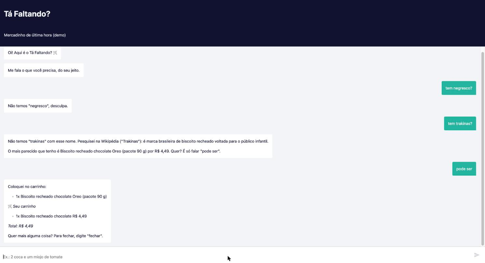

**Despensa.** O cliente pode contar o que já tem em casa ("tenho sal, alho e molho de tomate em casa"). Isso fica guardado para ele, aparece em "minha despensa" e sai quando ele avisa "acabou o sal", que também já coloca o sal no carrinho. Numa receita, o que está na despensa não entra no carrinho e aparece como "você já tem em casa". Nos combos do "me dá uma ideia" também fica de fora. No chat de teste a despensa é ligada à conversa; no WhatsApp ela ficaria ligada ao telefone.

**"Me dá uma ideia" sem gastar IA.** Quem não sabe o que pedir recebe 2 perguntas (pra quê e pra quantas pessoas) e 3 combos com preço, montados por regra só com o que tem em estoque. A quantidade acompanha o número de pessoas, e quem já disse que prefere zero recebe refrigerante zero no combo. Responder 1, 2 ou 3 coloca tudo no carrinho. Se no meio o cliente pede outra coisa ("2 coca"), o bot sai da sugestão e atende o pedido.

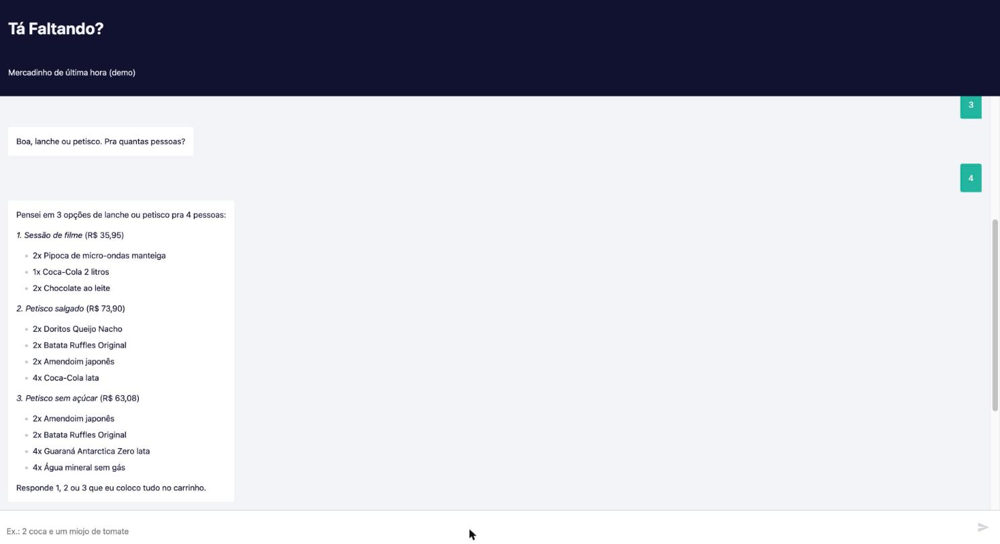

**+18 e Pix sem duplicar.** Bebida alcoólica fica em espera até o "sim". Se o cliente manda "fechar" de novo com o mesmo valor, recebe o mesmo Pix, sem criar outra cobrança. Abaixo de R$ 5,00, o mínimo do Asaas, o bot avisa quanto falta em vez de tentar gerar o Pix e falhar.

**Medir tudo.** Cada mensagem gera uma linha na tabela Eventos com a mensagem, a resposta, o tempo, se usou IA, a intenção e erro. Se o Airtable falhar, a resposta ao cliente sai do mesmo jeito.

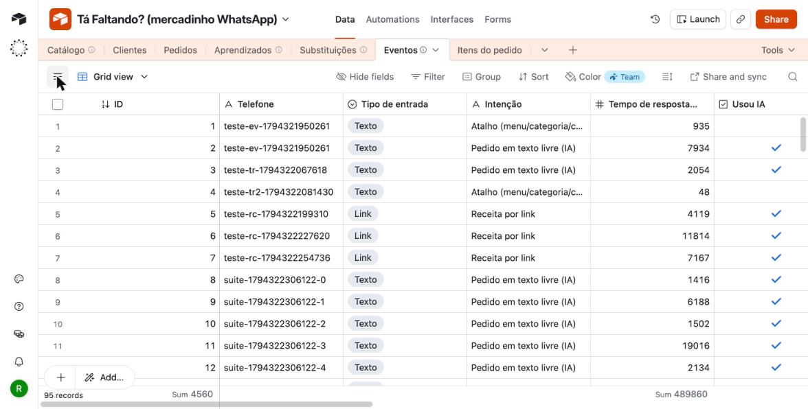

### Telas

| | |
|---|---|
| 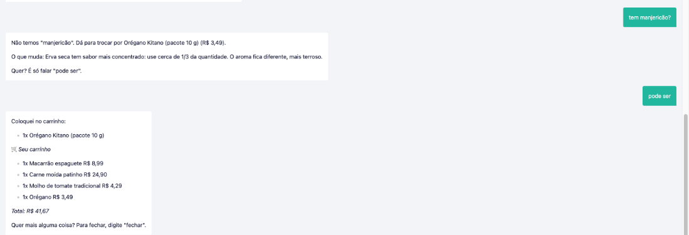 | 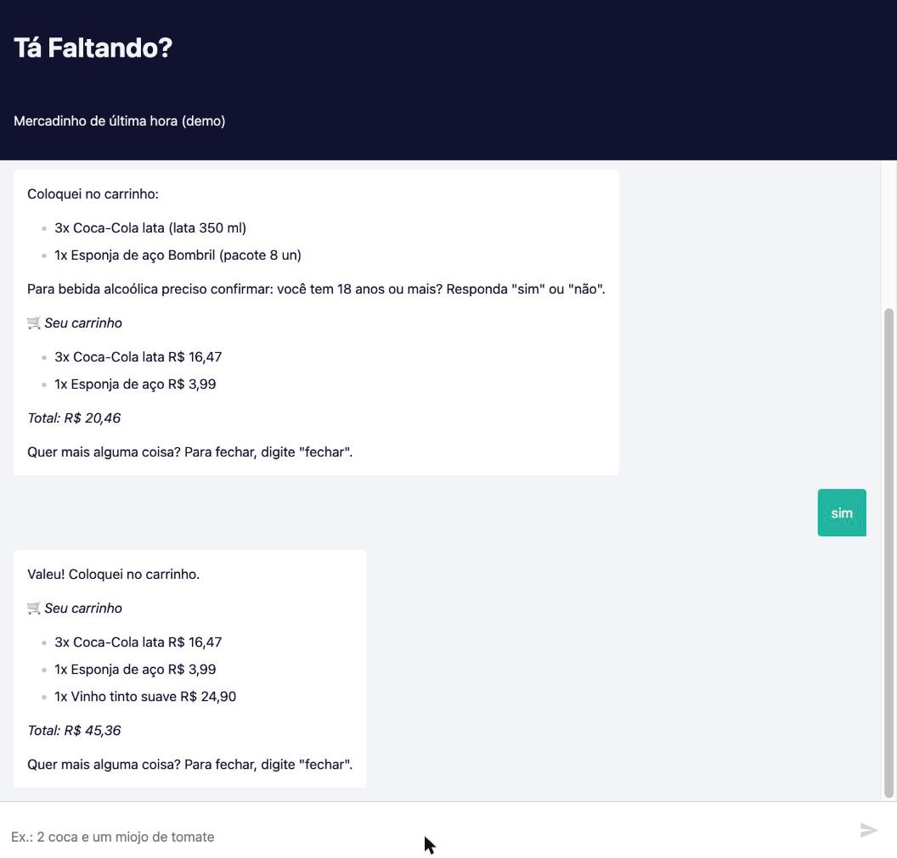 |
| Troca de manjericão por orégano, explicando o que muda | Confirmação de idade antes da cerveja |
| 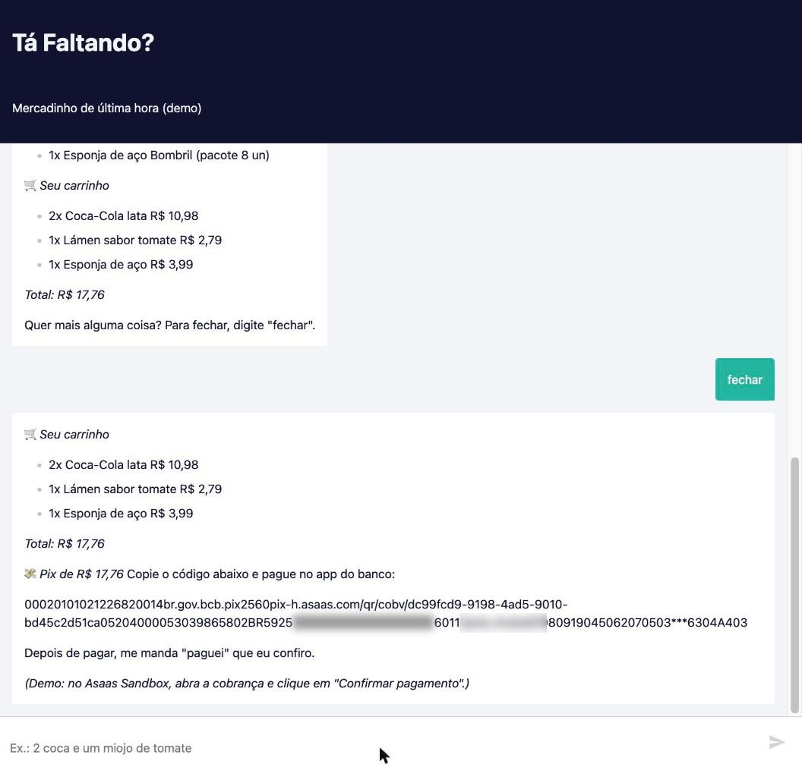 | 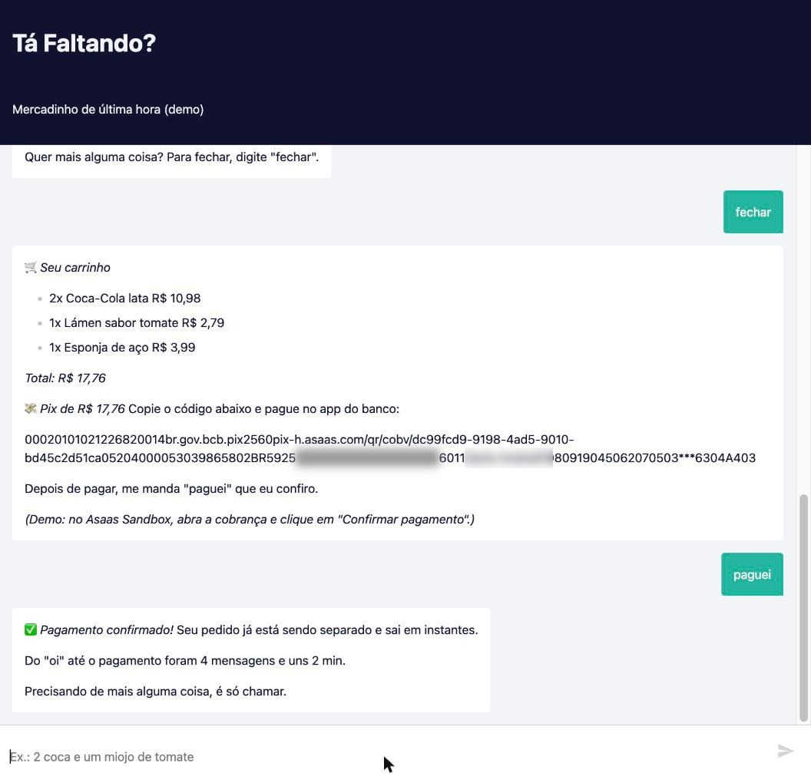 |
| "fechar" gera o Pix copia e cola (dados pessoais borrados) | "paguei" confere no Asaas e confirma |
| 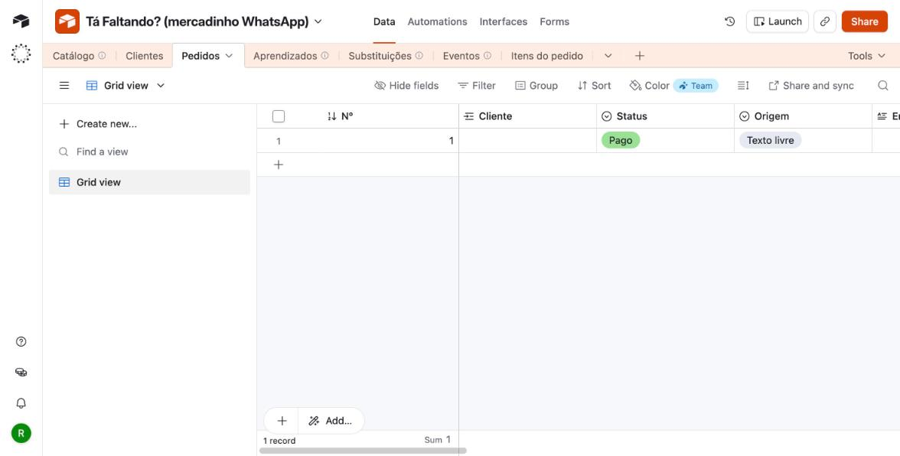 | 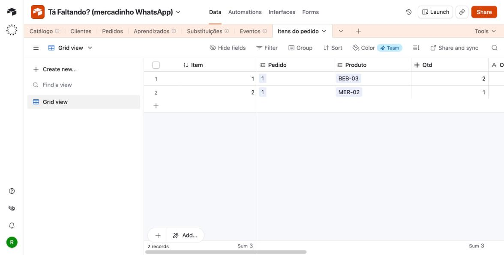 |
| Pedido gravado como pago | Itens ligados ao pedido e ao catálogo |

### Por que não está no WhatsApp

O plano era WhatsApp Cloud API. Na hora de ligar o número de teste, a Meta bloqueou a conta com "Falha na integração: você foi impedido temporariamente", três vezes no mesmo dia ([print](docs/prints/11_meta_bloqueio_temporario_05-11.jpg)). Em vez de parar, troquei a porta de entrada pelo chat do n8n. O resto do fluxo não depende do canal: para ligar WhatsApp ou Telegram, basta trocar o primeiro nó e o último.

### Limites e próximos passos

Depois de terminar as funções novas, refiz os testes procurando erro de propósito: lista torta e borrada, áudio com ruído e correção no meio, vídeo que não é receita, termos que a Wikipédia explica mal. O que achei:

**Falhou e foi corrigido no mesmo dia**
- Áudio com correção no meio ("me vê arroz... não, tira o arroz, põe feijão"): o arroz ficava no carrinho. Agora o áudio é transcrito palavra por palavra e a correção é entendida como num texto digitado.
- Vídeo que não é receita (um clipe de música): o bot dizia "não consegui assistir o vídeo". Agora diz que assistiu e não achou receita.
- Receita com "2 gemas de ovo" dizia que não tinha ovos.
- A IA às vezes punha "manteiga" em "não temos" mesmo com manteiga no catálogo. Agora o código confere: se o nome bate com um produto em estoque, ele entra.
- Troca oferecida para um produto que já estava no carrinho (tomate pelati → o molho que já tinha entrado).

**Funciona, mas é frágil**
- Áudio: só testei com voz sintética. Com ruído, a voz sintética saiu tão ruim que o Gemini ouviu "reservei o adiantamento" no lugar de "três guaraná zero", e o guaraná não entrou. A resposta mostra o que foi entendido, então o cliente vê o erro, mas ainda falta testar com voz de gente.
- Foto: a lista de teste é desenhada com fontes que imitam letra de mão. Leu 6 de 6 itens numa lista torta e borrada e ignorou o item riscado, mas letra de mão de verdade ainda não foi testada.
- Pesquisa na Wikipédia: depende de a página certa existir. "Catupiry" voltou sem explicação, "Sonho de Valsa" virou "wafer" e o bot não ofereceu chocolate, e produtos comuns que o mercado não vende ("sabão em pó") também passam pela pesquisa, o que é desnecessário. Leva de 5 a 20 s.
- Vídeo assistido pelo Gemini: de 7 a 60 s, dependendo da fila do plano gratuito. Com a lista na descrição, cerca de 8 s.
- Trava dos apelidos: conta clientes diferentes que pagaram. No chat de teste, cada página recarregada é um cliente novo, então uma pessoa sozinha conseguiria oficializar um apelido pagando 2 vezes. No WhatsApp, seriam 2 telefones diferentes. O dono pode marcar "Rejeitado" a qualquer momento.
- "Acabou o sal" já coloca 1 sal no carrinho sem perguntar.

**Ainda não feito**
- Painel do dono.
- Teste com pessoas de verdade, com foto e áudio delas.
- O tempo com IA passa de 10 s em cerca de 1 a cada 4 mensagens (11 de 48 na 3ª rodada), por causa da fila do plano gratuito do Gemini. Próximo passo: avisar "um instante" depois de 3 s e comparar com um modelo pago.

### Como rodar

1. Suba o n8n com Docker e importe `workflow/atendimento_carrinho_ia.json`.
2. Crie as credenciais: Google Gemini, Airtable (token pessoal) e Asaas Sandbox (cabeçalho `access_token`).
3. Monte a base no Airtable com `testes/catalogo.csv` e as tabelas citadas acima, e troque os IDs de base e tabela nos nós.
4. Publique o fluxo e abra a URL pública do chat.

As frases de teste e o gabarito estão em [`testes/frases_de_teste.md`](testes/frases_de_teste.md). Para repetir o teste no seu n8n, rode `node testes/rodar_testes.mjs` (Node 18 ou mais novo): ele manda os 40 casos, cada uma numa conversa nova, confere o carrinho e mostra o acerto e o tempo.
